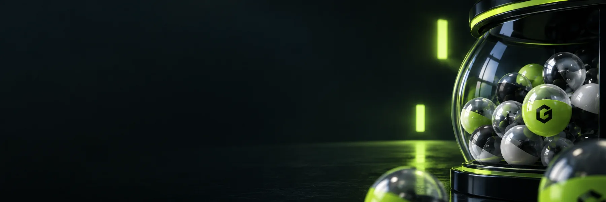
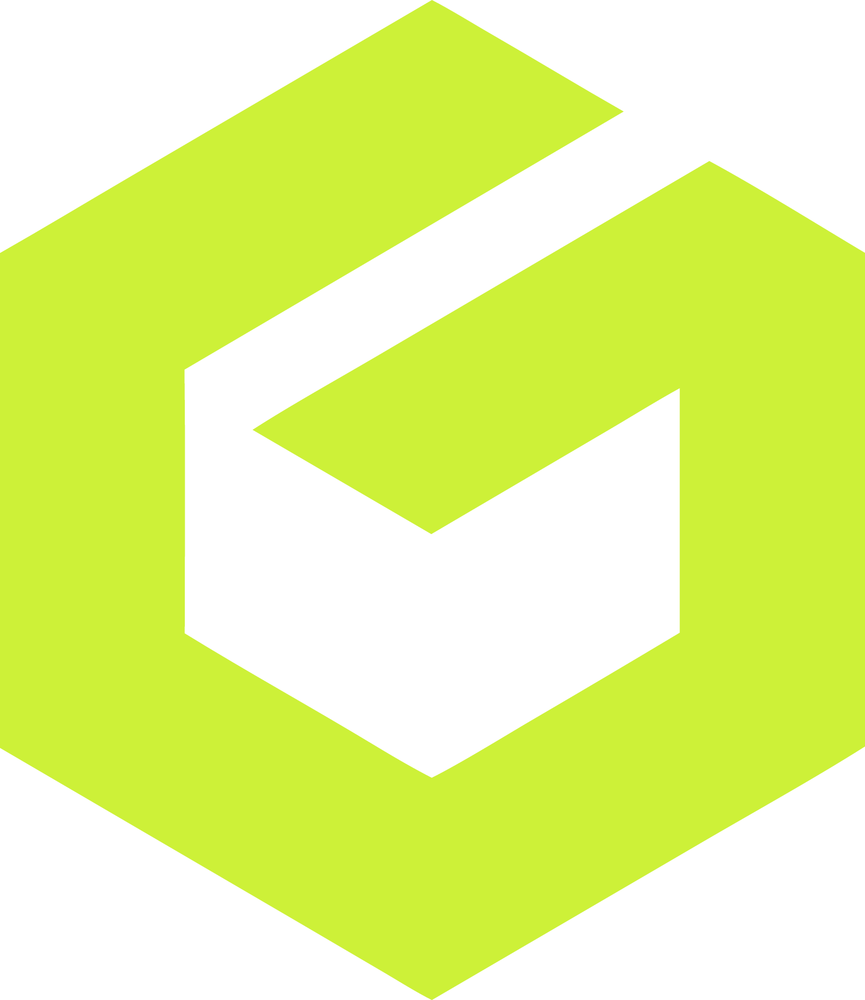
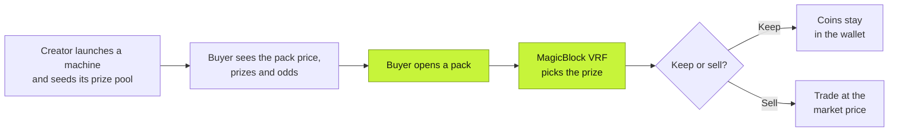

# Gabox

**Gacha machines for Solana coins. Open a pack, win the coin, check every roll onchain.**

[gabox.fun](https://gabox.fun) · [Docs](https://docs.gabox.fun) · [Developers](https://gabox.fun/developers) · [Agent skill](https://github.com/gabox-labs/skills) · [hello@gabox.fun](mailto:hello@gabox.fun)

Gabox is a marketplace of onchain gacha machines. Every machine holds one coin. You open a pack at a fixed USDC price, MagicBlock VRF picks a prize from the machine's public table, and the prize is paid in that coin.

## Two kinds of machine

| | New-coin machine | Fan coin machine |
| --- | --- | --- |
| The coin | Launched with the machine, in one transaction | A coin that already trades, like BONK or JUP |
| Market | Meteora bonding curve, then a DAMM v2 pool | Wherever the coin already trades |
| Snipers | Blocked: until graduation, only packs can buy on the curve | Not relevant: the coin trades openly |
| Top prize | 3× to 20× the pack, chosen at launch | 3× to 100× the pack, chosen at launch |
| Creator earns | Part of the trading fee | 1.20% of every pack (1.50% with no referrer) |
| Pack fee | 0.50% | 2% |

## The loop

1. **Launch.** Launch a new coin and its machine in one transaction, or open a machine on a coin that already trades. Pick the top prize and seed the prize pool.
2. **Choose.** Packs cost $10, $50, $200, $500 or $1,000 in USDC. On a new coin, the $1,000 pack unlocks after graduation. The pack's USDC buys the coin, and those coins go into the prize pool.
3. **Open.** MagicBlock VRF picks a prize row. The prize is a multiple of the coins your pack bought, paid to your wallet.
4. **Keep or sell.** Hold the coins, or sell them at the market price.

## How the machine stays honest

- **Odds are public.** Each machine's prize table is fixed at launch. The admin can raise a table's average payout, never lower it.
- **Prizes are funded.** Every pack reserves its own coins before the draw. One draw can never spend the coins another draw holds.
- **The draw is frozen.** Your pack keeps the table and prize pool snapshot from the moment you bought.
- **The result is checkable.** MagicBlock VRF supplies the randomness, and onchain events record the inputs and the outcome of every draw.
- **The seed stays.** A creator can never take back the seed or the coins packs added.

## At a glance

| | |
| --- | --- |
| **Pack prices** | $10 · $50 · $200 · $500 · $1,000 (USDC) |
| **Prizes** | Up to 8 rows, set at launch; up to 100× the pack |
| **Average payout** | About 0.955× the pack's coins on the app's tables. A pack is a game, not an investment. |
| **Randomness** | MagicBlock VRF |
| **Market** | Meteora DBC, then Meteora DAMM v2, or the coin's own market |

## Status

Gabox is **live on Solana mainnet**. The program and transfer hook run the same source on mainnet and devnet:

| | Address |
| --- | --- |
| Gabox program | `GaBoxR9nYcK1zeu8EvSJVHV3SrYpCFmvbh2MLgobMcUA` |
| Gabox transfer hook | `GaHokC2ogWdrH8FZkq9qssUaRhWktF3uc4HPbfRtFqfL` |

See [Deployment status](https://docs.gabox.fun/status-and-addresses) and [Risks](https://docs.gabox.fun/risks) before you buy.

---

Questions, feedback, or a coin you want a machine for? [hello@gabox.fun](mailto:hello@gabox.fun)

